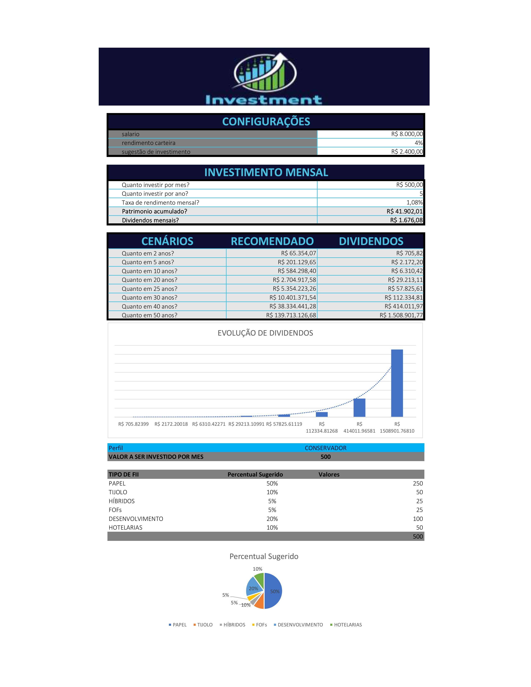
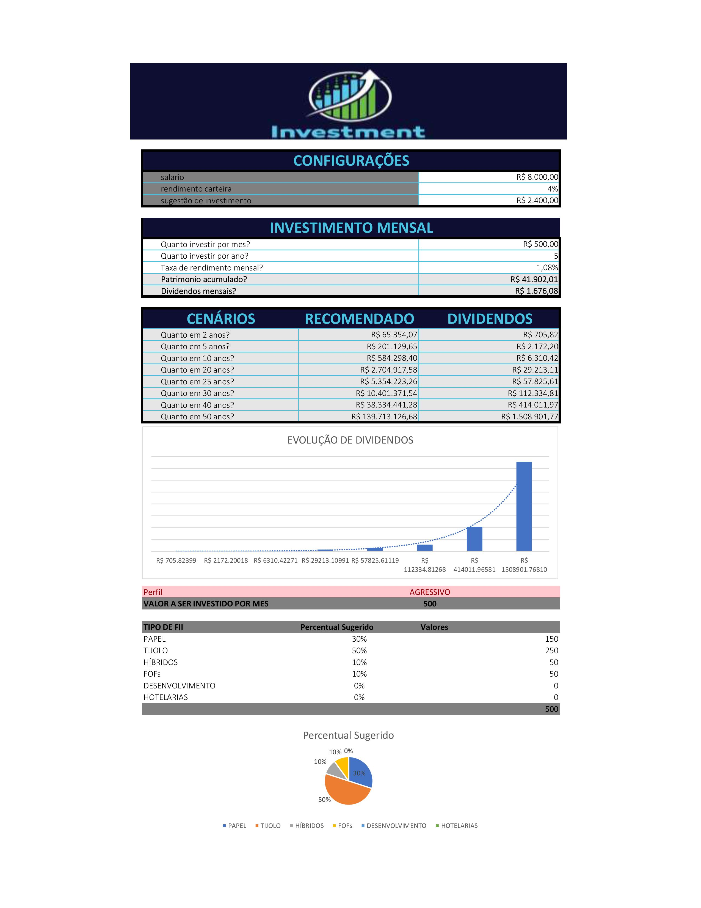

Simulador de Investimentos em Fundos Imobiliários
Sobre o projeto

Simulador de investimentos em Fundos Imobiliários (FIIs) desenvolvido no Excel, com o objetivo de auxiliar na visualização do crescimento do patrimônio ao longo do tempo e na estimativa de dividendos mensais.

A ferramenta permite simular investimentos com aportes mensais personalizados ou com base em uma sugestão de aporte equivalente a 30% do salário, além de distribuir os investimentos conforme diferentes perfis de investidor.

Funcionalidades
Simulação de investimentos com aportes mensais.
Opção de utilizar o aporte informado pelo usuário ou o aporte recomendado com base em 30% do salário.
Cálculo do patrimônio acumulado.
Estimativa de dividendos mensais.
Projeção de patrimônio em 2, 5, 10, 20, 25, 30, 40 e 50 anos.
Gráfico de colunas para visualizar a evolução dos dividendos.
Distribuição dos aportes entre seis tipos de fundos imobiliários.
Seleção de perfil de investidor por lista suspensa.
Sugestão de aporte baseada no salário.
Formatação condicional no campo de seleção de perfil, com alteração automática da cor conforme o perfil de investidor escolhido.

Recursos do Excel utilizados
Formatação condicional: alteração automática da cor do campo de perfil conforme a opção selecionada, facilitando a identificação visual do perfil de investidor.
VF: cálculo do valor futuro dos investimentos.
PROCV: busca dos percentuais de distribuição conforme o perfil de investidor.
Validação de dados: criação de lista suspensa para seleção dos perfis.
Intervalos nomeados: utilização de nomes para facilitar a identificação das células nas fórmulas.
Referências absolutas: manutenção das referências durante a projeção dos cenários.
Gráficos: representação visual da evolução dos dividendos.
Objetivo de aprendizagem

Desenvolver uma ferramenta interativa no Excel, aplicando fórmulas financeiras, funções de busca, organização de dados e recursos de visualização para solucionar um problema de negócio.

Tecnologias utilizadas
Microsoft Excel
Observação

Este projeto foi desenvolvido para fins educacionais. Os percentuais e simulações são exemplos e não representam recomendações de investimento.

## Evidências do projeto

### Visão geral da ferramenta

### Simulação com perfil Conservador

### Simulação com perfil Agressivo

